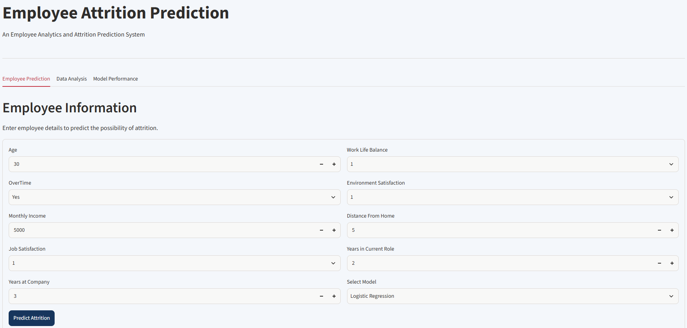

# Employee Attrition Prediction

## Project Overview
Employee Attrition Prediction is a Machine Learning project that analyzes employee data and predicts whether an employee is likely to leave an organization.

The project uses the IBM HR Employee Attrition dataset and implements multiple machine learning classification models.

## Features
- Exploratory Data Analysis (EDA)
- Data preprocessing and categorical encoding
- Data visualization
- Machine Learning model training
- Model evaluation and comparison
- Interactive Streamlit dashboard

## Machine Learning Models
The project includes:
- Logistic Regression
- Support Vector Machine (SVM)
- Decision Tree Classifier

## Technologies Used
- Python
- Pandas
- NumPy
- Matplotlib
- Seaborn
- Scikit-learn
- Streamlit
- Joblib

## Project Structure

```text
Employee-Attrition-Prediction/
│
├── dataset/
│   ├── WA_Fn-UseC_-HR-Employee-Attrition.csv
│   └── Figure_1.png ... Figure_5.png
│
├── models/
│   └── Visualization files
│
├── app.py
├── data_analysis.py
├── train_model.py
├── logistic_regression_model.pkl
├── svm_model.pkl
├── decision_tree_model.pkl
├── scaler.pkl
├── model_columns.pkl
├── model_results.csv
├── requirements.txt
└── README.md
```

## Installation

1. Clone the repository:

```bash
git clone https://github.com/RomaisaZafar/Employee-Attrition-Prediction.git
```

2. Open the project folder:

```bash
cd Employee-Attrition-Prediction
```

3. Install dependencies:

```bash
pip install -r requirements.txt
```

4. Run the Streamlit application:

```bash
streamlit run app.py
```

## Dataset
The project uses the IBM HR Employee Attrition dataset containing employee-related information for analyzing attrition patterns.

## Project Goal
The main goal is to apply machine learning techniques to understand employee attrition and support data-driven HR decisions.

## Author
Machine Learning Project – Employee Attrition Prediction
## Dashboard Preview

The following screenshot shows the Employee Attrition Prediction dashboard.

